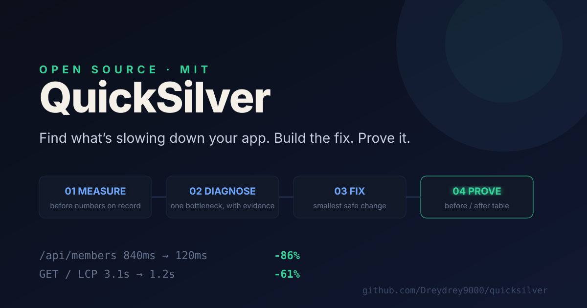
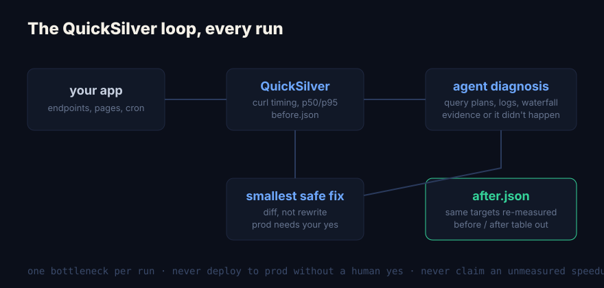

# QuickSilver ⚡



**Your app is slow. You don't need a consultant, you need a loop.**

QuickSilver is an open-source performance agent that shows up on a schedule and does four things, every run:



1. **Measure** — times your app's most-hit endpoints and pages. Before numbers, on record.
2. **Diagnose** — traces the single biggest bottleneck with evidence: query plans, logs, waterfalls. Never vibes.
3. **Fix** — builds the smallest safe fix. Production always needs your yes.
4. **Prove** — re-measures the exact same targets and hands you the table.

```
endpoint          before   after   delta
/api/members      840ms   120ms   -86%
GET / (LCP)       3.1s    1.2s    -61%
/api/seats        210ms    95ms   -55%
```

## Why this exists

Most performance work dies in the "we should look into that" phase. Weeks pass, nobody profiles anything, the app keeps getting slower. QuickSilver removes the decision: every week you get one measurement, one bottleneck, one fix, and proof it worked. You just say yes.

It's the agent version of the thing every senior engineer tells you to do and nobody ever does.

## House rules

These are load-bearing. The tool is honest because of them.

- **One bottleneck per run.** No whack-a-mole. Focus is the feature.
- **Never deploy to production without a human yes.** Fixes ship as diffs until approved.
- **Never report an improvement it didn't measure.** Every delta comes from a real re-run.
- **If the fix wins less than 10%, it says so and reverts.** Honest losses, no theater.

## Works with the agent you already use

QuickSilver ships as a plain prompt plus a script kit. Any runtime that can run shell commands can run it:

- Claude Code, Codex, Cursor, Hermes Agent — feed it `prompts/agent.md`
- Plain cron — `quicksilver.sh --report` needs no agent at all

## Quick start

Requirements: bash, curl, python3.

```bash
git clone https://github.com/Dreydrey9000/quicksilver.git
cd quicksilver
cp config.example.json config.json   # list your URLs
./quicksilver.sh --measure           # read-only, safe anywhere
```

Schedule it (Fridays 9am):

```
0 9 * * 5 /path/to/quicksilver.sh --report
```

Full loop with an agent: run `./quicksilver.sh` (the `full` mode), hand `prompts/agent.md` plus `reports/before.json` to your agent, and it diagnoses, fixes, then runs `--after` to produce the table.

## What's in the box

| File | What it is |
|---|---|
| `quicksilver.sh` | the pass runner: measure / full / after / report |
| `lib/measure.py` | curl-based timing, p50 and p95, stable JSON |
| `lib/compare.py` | pairs before and after into one table |
| `prompts/agent.md` | the agent system prompt, runtime-agnostic |
| `config.example.json` | target list format |
| `assets/` | hero and diagram, yours to steal |

## Honest limits

- v1 targets HTTP endpoints and page loads. Database-level work reads your app's own slow-query log.
- Authenticated routes need a token in config (never commit it).
- One fix per pass is a feature, not a limitation.

## Who made this

QuickSilver runs as the performance department of [Drey Thomas](https://dreythomas.com)'s agent org. Want it installed and tuned on your stack? [dreythomas.com/quicksilver](https://dreythomas.com/quicksilver).

## License

MIT. Free forever. Use it, ship it, sell the result.


## RAMsey partnership

[Agent RAMsey](https://github.com/Dreydrey9000/agent-ramsey) checks Mac capacity and protects active work. QuickSilver fixes one app bottleneck. A coordinating assistant carries the explicit handoff; neither kit starts an agent polling loop. See the editable [team workflow](docs/diagrams/team.mmd) and [rendered overview](docs/diagrams/team.svg). Resource readings and app latency are separate measurements; never claim RAM savings from speed alone. Existing production-approval and read-only Mac rules remain in force.
